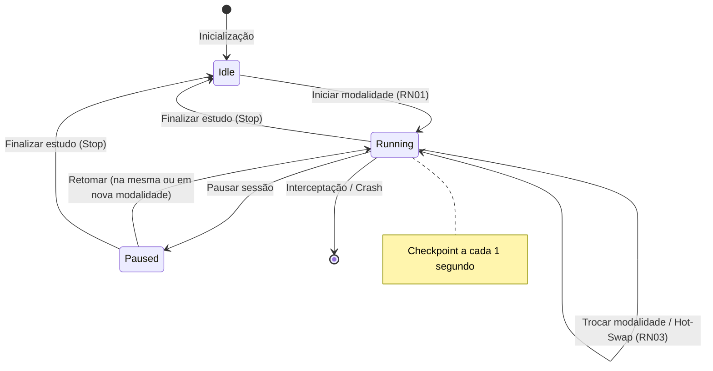

# Especificação Técnica do Sistema: StudyChrono

| Metadado | Detalhe |
| :--- | :--- |
| **Versão da Especificação** | 2.0.0 (Living Architecture Specification) |
| **Status do Projeto** | Produção / Estável |
| **Arquitetura** | Dual-Engine: Desktop Nativo (Tauri v2 + Rust) & Web SPA (TypeScript WebTracker) |
| **Licença** | MIT |

---

## 1. Visão Geral e Princípios Arquiteturais

O **StudyChrono** é uma aplicação de alta precisão dedicada ao rastreamento e segmentação de horas líquidas e brutas de estudo. Diferente de cronômetros genéricos ou temporizadores Pomodoro convencionais, o sistema divide o tempo investido em **quatro modalidades cognitivas de estudo** além do controle rigoroso de **intervalos (pausas)**:

1. 📖 **Leitura** (PDFs, livros, doutrina, legislação, apostilas)
2. 🎧 **Videoaula / Áudio** (Aulas gravadas, podcasts, transmissões ao vivo)
3. 🔄 **Revisão** (Flashcards Anki, mapas mentais, resumos pessoais, fichamentos)
4. ✍️ **Resolução de Questões** (Baterias de exercícios, simulados, provas anteriores)
5. ⏸️ **Intervalos / Pausas** (Descanso controlado sem poluir o tempo líquido)

### Princípios de Engenharia

* **Zero-Drift & Precisão Absoluta:** O cálculo de tempo é imune à latência de loops de eventos, desvio de temporizadores JavaScript (`setInterval`) ou congelamento de abas em segundo plano (*background throttling* em navegadores modernos).
* **Dual-Engine Architecture (Motor Dual):**
  - **No Desktop:** Opera sob o padrão *Thick Rust Core + Dumb Reactive UI*, onde o Rust é a única fonte da verdade (*Single Source of Truth*) via `std::time::Instant` e SQLite embutido.
  - **Na Web / Mobile:** Opera sob o motor *WebTracker*, utilizando diferencial de timestamps absolutos (`Date.now()`), persistência reativa em `localStorage` e suporte a sincronização via Google Drive API.
* **Local-First & Privacidade por Padrão:** Não requer cadastro prévio para uso imediato (Modo Visitante). Todos os dados residem localmente na máquina do usuário, com opções de backup e sincronização sob demanda.
* **Design Editorial Minimalista:** Visor de cronometragem 100% focado na sessão ativa, tipografia editorial balanceada (três famílias de fontes complementares), paleta monocromática com uso restrito de cor apenas para semântica de controle (Play, Pause, Stop).

---

## 2. Stack Tecnológica Detalhada

| Camada | Tecnologia / Biblioteca | Versão | Papel e Justificativa no Sistema |
| :--- | :--- | :--- | :--- |
| **Frontend Framework** | **React** | 19.x | Componentização reativa de alto desempenho e sincronização de estado. |
| **Linguagem Frontend** | **TypeScript** | 6.x | Tipagem estática estrita em todos os modelos de dados e serviços. |
| **Build Tool & Bundler** | **Vite** | 8.x | Compilação ultrarrápida, Hot Module Replacement e geração de chunks otimizados. |
| **Estilização** | **Tailwind CSS** | 4.x | Utilitários CSS de alto desempenho, suporte nativo a `@custom-variant dark`. |
| **Ícones** | **Lucide React** | 1.6x | Conjunto consistente de ícones vetoriais leves. |
| **Tipografia Offline** | **Fontsource Variable** | 5.3x | Fontes variáveis empacotadas no binário/dist (*Newsreader*, *Inter*, *Roboto Mono*). |
| **Desktop Shell** | **Tauri** | 2.x | Ponte IPC segura, consumo mínimo de memória e empacotamento nativo. |
| **Desktop Backend** | **Rust** | Edição 2024 | Lógica de domínio, máquina de estados monotônica e segurança de concorrência. |
| **Banco Desktop** | **SQLite (`rusqlite`)** | 0.32 (bundled) | Banco relacional embarcado no binário único, dispensando drivers externos. |
| **Web Engine** | **TypeScript WebTracker** | Nativo | Motor temporal para Web SPA baseado em diferencial de timestamps absolutos. |
| **Containerização** | **Docker + Nginx Alpine** | Node 22 / Nginx | Multi-stage build com cabeçalhos de segurança, Gzip e suporte a Cloud Run. |
| **Suíte de Testes** | **Node.js Test Runner** | 20+ | Testes unitários rápidos (`npm test`) e responsividade móvel (`npm run test:responsive`). |

---

## 3. Estrutura de Diretórios do Projeto

```text
study-chrono/
├── public/                         # Ativos públicos e ícones estáticos
├── src/                            # Camada Frontend (React + TypeScript)
│   ├── assets/                     # SVGs e imagens auxiliares
│   ├── components/                 # Componentes de interface modulares
│   │   ├── CloseConfirmModal.tsx   # Modal de proteção contra fechamento com sessão ativa
│   │   ├── ControlBar.tsx          # Ações principais: Iniciar, Pausar/Retomar e Finalizar
│   │   ├── HistoryReport.tsx       # Aba dedicada de histórico, filtros, paginação e edição
│   │   ├── ModalityGrid.tsx        # Grade das 4 modalidades de estudo com contadores
│   │   ├── SubjectInput.tsx        # Entradas de Matéria (autocomplete inteligente) e Tópico
│   │   ├── TimerDisplay.tsx        # Visor principal com décimos discretos (.0 a .9)
│   │   ├── UserMenuPopover.tsx     # Menu flutuante de ações rápidas da conta
│   │   └── UserProfileModal.tsx    # Modal de perfil, login Google, nuvem e backup JSON
│   ├── config/
│   │   └── googleAuth.ts           # Configurações do Google OAuth 2.0 Client ID
│   ├── services/
│   │   ├── authService.ts          # Gestão de identidades (Visitante, Demo e Google)
│   │   ├── googleDriveService.ts   # Sincronização em nuvem via Google Drive REST API
│   │   ├── tauriApi.ts             # Fachada de abstração unificada (Tauri IPC vs WebTracker)
│   │   └── webTracker.ts           # Motor de contagem temporal para navegador e LocalStorage
│   ├── types/
│   │   └── session.ts              # Contratos tipados: Modality, Snapshot, Records, UserProfile
│   ├── utils/
│   │   ├── formatTime.ts           # Utilitários de formatação de horas, minutos e décimos
│   │   └── useModalFocusTrap.ts    # Hook de acessibilidade para retenção de foco em modais
│   ├── App.tsx                     # Orquestrador principal, estado global e layout responsivo
│   ├── App.css                     # Importação Tailwind v4 e fontes @font-face offline
│   └── main.tsx                    # Bootstrap da aplicação React
├── src-tauri/                      # Camada Backend Desktop (Rust)
│   ├── src/
│   │   ├── commands.rs             # Endpoints IPC tipados (#[tauri::command])
│   │   ├── db.rs                   # Inicialização do SQLite, migrações e rotina de Crash Recovery
│   │   ├── domain.rs               # Enums (Modality, TrackerState) e structs de domínio
│   │   ├── lib.rs                  # Inicialização do runtime Tauri e interceptação de janela
│   │   ├── main.rs                 # Ponto de entrada do executável Desktop
│   │   └── timer.rs                # Motor monotônico com Instant e Duration em nanossegundos
│   ├── Cargo.toml                  # Dependências Rust e otimizações de compilação LTO
│   └── tauri.conf.json             # Configuração da janela nativa, permissões e ícones
├── tests/                          # Suíte de testes automatizados
│   ├── frontend.test.mts           # Testes unitários da lógica Web, formatação e recuperação
│   ├── responsive-usability.test.mts # Testes de layout adaptativo móvel e acessibilidade
│   └── e2e-binary.test.mts         # Testes ponta-a-ponta via Chrome DevTools Protocol
├── Dockerfile                      # Build multi-stage para deploy em contêineres web
├── nginx.conf                      # Servidor Nginx com Security Headers e compressão Gzip
├── SPEC.md                         # Este documento de especificação técnica
└── README.md                       # Documentação e guia rápido do projeto
```

---

## 4. Modelagem de Dados e Esquemas de Persistência

### 4.1. Esquema Relacional Desktop (SQLite)

O banco `study_chrono.db` é criado automaticamente no diretório de dados do usuário (`app_data_dir`) pelo hook `setup` do Tauri:

```sql
CREATE TABLE IF NOT EXISTS study_sessions (
    id INTEGER PRIMARY KEY AUTOINCREMENT,
    study_date TEXT NOT NULL,            -- Formato local YYYY-MM-DD
    start_time TEXT NOT NULL,            -- Timestamp ISO-8601 (ex: 2026-11-01T14:30:00-03:00)
    end_time TEXT,                       -- Timestamp ISO-8601 de encerramento
    subject TEXT NOT NULL,               -- Nome da matéria (higienizada com trim)
    topic TEXT NOT NULL DEFAULT '',      -- Conteúdo ou assunto detalhado
    time_reading_sec INTEGER NOT NULL DEFAULT 0,   -- Tempo em Leitura (segundos)
    time_media_sec INTEGER NOT NULL DEFAULT 0,     -- Tempo em Videoaula/Áudio (segundos)
    time_review_sec INTEGER NOT NULL DEFAULT 0,    -- Tempo em Revisão (segundos)
    time_questions_sec INTEGER NOT NULL DEFAULT 0, -- Tempo em Questões (segundos)
    time_paused_sec INTEGER NOT NULL DEFAULT 0,    -- Tempo em Intervalos/Pausas (segundos)
    total_active_sec INTEGER NOT NULL DEFAULT 0,   -- Soma das 4 modalidades ativas
    status TEXT NOT NULL DEFAULT 'IN_PROGRESS'     -- 'IN_PROGRESS' | 'COMPLETED' | 'RECOVERED'
);

CREATE INDEX IF NOT EXISTS idx_study_sessions_date ON study_sessions(study_date);
CREATE INDEX IF NOT EXISTS idx_study_sessions_subject ON study_sessions(subject);
```

### 4.2. Esquema Web Storage (`localStorage`)

No ambiente Web, o sistema persiste os dados em chaves isoladas no navegador:

| Chave de Armazenamento | Tipo de Dado | Finalidade |
| :--- | :--- | :--- |
| `study_chrono_active_session` | `ActiveSessionData` (JSON) | Estado instantâneo da sessão ativa, acumuladores em ms e timestamps de fatia. |
| `study_chrono_history` | `StudySessionRecord[]` (JSON) | Lista histórica de sessões concluídas ou recuperadas. |
| `study_chrono_subjects` | `string[]` (JSON) | Lista canônica de matérias cadastradas para o autocomplete inteligente. |
| `study_chrono_theme` | `"light" \| "dark"` | Modo visual preferido pelo usuário. |
| `study_chrono_user` | `UserProfile` (JSON) | Perfil atual (`guest`, `demo` ou `google`), nome, e-mail e avatar. |
| `study_chrono_storage_mode` | `"local" \| "drive"` | Destino preferencial de sincronização e persistência. |
| `study_chrono_google_client_id` | `string` | Client ID personalizado para OAuth do Google. |
| `study_chrono_last_drive_sync` | `string` (ISO-8601) | Timestamp do último backup concluído com o Google Drive. |

---

## 5. Motor de Precisão Temporal & Máquina de Estados

### 5.1. Estados da Sessão (`TrackerStatus`)

O ciclo de vida da contagem segue o autômato finito de três estados:



1. **`Idle` (Inativo):** Nenhuma contagem em andamento. O visor exibe `00:00:00.0`. Os botões de modalidade atuam como gatilho de início imediato.
2. **`Running` (Executando):** Há uma modalidade ativa acumulando tempo. O relógio principal avança em tempo real e calcula os décimos discretos (`.0` a `.9`). Checkpoints são gravados a cada segundo.
3. **`Paused` (Pausado):** A contagem líquida é congelada. O acumulador de pausas passa a registrar a duração do intervalo. O visor principal muda para o tom âmbar e sinaliza o estado de pausa.

### 5.2. Prevenção de Perdas Sub-segundo (*Sub-second Precision*)

Para evitar que trocas rápidas de modalidade (ex: transição aos `3.7` segundos) causem truncamento de tempo real:
* **No Rust (`timer.rs`):** Todos os acumuladores internos são armazenados em `std::time::Duration` com precisão de nanossegundos. A conversão para segundos inteiros ocorre somente na exportação e persistência.
* **No WebTracker (`webTracker.ts`):** Todos os acumuladores (`readingMs`, `mediaMs`, etc.) e fatias parciais utilizam milissegundos absolutos baseados em `Date.now()`.

### 5.3. Imunidade à Suspensão de Abas (*Background Tab Throttling*)

Navegadores modernos reduzem a frequência de execução de `setInterval` para até 1 vez por minuto em abas inativas. Para contornar esse comportamento:
* O cronômetro **nunca soma deltas arbitrários por tick de timer**.
* A cada ciclo de renderização, o tempo decorrido da fatia ativa é calculado exclusivamente pela fórmula:
  $$\Delta t = \text{Date.now()} - \text{sliceStartTime}$$
  $$\text{tempo\_total} = \text{acumulador\_anterior} + \Delta t$$
* Mesmo que o navegador congele o loop de renderização durante uma hora de estudo com a aba minimizada, ao reativar a aba o cálculo por diferencial de relógio do sistema apresentará o tempo exato decorrido.

---

## 6. Regras de Negócio Oficiais

### RN01 — Início Rápido pela Modalidade
* Com o sistema em `Idle`, o usuário não necessita clicar em um botão preliminar de "Iniciar".
* Ao preencher a **Matéria** e clicar diretamente em qualquer um dos 4 botões de modalidade (**Leitura**, **Videoaula**, **Revisão** ou **Questões**), a sessão é iniciada imediatamente naquela modalidade.
* Caso a matéria esteja vazia, o sistema assume automaticamente a denominação padrão **"Estudo Livre"**, garantindo que o usuário nunca seja impedido de iniciar seus estudos de imediato.

### RN02 — Edição Dinâmica de Metadados em Tempo Real
* Os campos de **Matéria** e **Conteúdo / Tópico** permanecem editáveis durante a execução (`Running`) e durante a pausa (`Paused`).
* Alterações no texto disparam atualizações automáticas via *debounce* e no evento `onBlur`, sincronizando a sessão em andamento com o banco de dados sem reiniciar ou pausar os contadores.

### RN03 — Troca Quente de Modalidade (*Hot-Swap*)
* Clicar no botão da modalidade que já está em execução é uma operação idempotente (mantém a execução contínua).
* Clicar em uma modalidade diferente transfere instantaneamente a contagem ativa para a nova modalidade, consolidando a fatia anterior no acumulador sem perder frações de segundo e sem interromper o tempo líquido total.
* Estando o cronômetro **Pausado**, clicar diretamente em qualquer modalidade encerra a pausa automaticamente e retoma o cronômetro na modalidade selecionada.

### RN04 — Interceptação Nativa de Fechamento da Janela
* **No Desktop (Tauri):** O evento `WindowEvent::CloseRequested` é interceptado. Se houver sessão em `Running` ou `Paused`, o fechamento é bloqueado (`api.prevent_close()`) e o modal `CloseConfirmModal` é exibido, permitindo:
  - *Continuar Estudando:* Fecha o modal e mantém a sessão rodando normalmente.
  - *Encerrar, Salvar e Sair:* Consolida o tempo decorrido no banco SQLite e finaliza o processo do aplicativo de forma limpa.
* **Na Web:** O evento `beforeunload` exibe o diálogo nativo de proteção do navegador, enquanto grava um checkpoint síncrono da sessão.

### RN05 — Auto-Recuperação de Queda (*Crash Recovery*)
* Se o computador ou a aba do navegador for encerrada inesperadamente (ex: queda de energia ou fechamento forçado):
  - Na próxima inicialização, o sistema identifica sessões com status `IN_PROGRESS`.
  - O status é automaticamente atualizado para `RECOVERED` ("Encerramento inesperado") com a data de término igual ao último checkpoint salvo.
  - A sessão recuperada é incorporada ao histórico, preservando integralmente o tempo estudado.

### RN06 — Modo Visitante Zero-Friction e Autenticação Google
* O usuário pode utilizar o StudyChrono de imediato no modo visitante, sem qualquer tipo de login ou autorização prévia.
* A qualquer momento, é possível alternar para um perfil de demonstração (*Demo User*) ou realizar login oficial via Google OAuth 2.0 (Identity Services) para associar seu histórico a uma conta pessoal.

### RN07 — Armazenamento Local e Sincronização Google Drive
* O usuário escolhe entre manter seus dados puramente locais (*Armazenamento Local*) ou sincronizá-los com o seu Google Drive pessoal (*Google Drive*).
* A sincronização com o Google Drive utiliza a pasta de dados da aplicação (`drive.file` / `appDataFolder`), salvando o arquivo `study-chrono-backup.json` sem acessar quaisquer outros arquivos pessoais do usuário.

### RN08 — Portabilidade e Backup Total (JSON Import/Export)
* O sistema fornece exportação completa do banco de dados/histórico em formato JSON estruturado contendo versão do esquema, perfil, matérias e histórico de sessões.
* A importação de arquivos JSON realiza mesclagem inteligente e deduplicação de registros por timestamp e identificador.

### RN09 — Relatório de Histórico Isolado com Paginação e Ações Seguras
* A visualização de histórico reside em uma aba dedicada (`history`), mantendo a tela do cronômetro (`timer`) 100% livre de distrações durante os estudos.
* A aba de histórico oferece:
  - Paginação automática com seletor de itens por página.
  - Filtros combinados por matéria, período de datas e busca por texto no tópico.
  - Totais consolidados em cartões destacados por modalidade.
  - Edição em linha de matéria e tópico de sessões passadas.
  - Exclusão com confirmação em pop-up de segurança.

### RN10 — Interface Responsiva e Navegação Adaptativa
* **Desktop:** Cabeçalho unificado com altura padrão `h-8`, abas de navegação centralizadas (*Cronômetro* e *Histórico*), alternância de tema Claro/Escuro e menu do usuário à direita.
* **Mobile / Telas Estreitas:** Cabeçalho compacto com marca centralizada e alternador de tema; navegação principal movida para uma barra inferior fixa (*Bottom Navigation Bar*), com padding de segurança inferior no corpo da página para evitar sobreposição de controles.

---

## 7. Design System & Especificações Editorial/UX

### 7.1. Sistema Tipográfico Tríplice

O design adota uma hierarquia tipográfica precisa, suportada por fontes variáveis empacotadas localmente para funcionamento 100% offline:

```text
[ Serif Editorial: Romana-Book / Newsreader ]
└── Títulos, Identidade Visual (StudyChrono) e Cabeçalhos de Seção

[ Mono Técnico: Akkurat-Mono / Roboto Mono ]
└── Visor Numérico Principal (00:00:00.0), Badges de Status, Rótulos de Tempo

[ Sans Neutra: AkkuratPro-Regular / Inter ]
└── Rótulos de Formulários, Textos de Ajuda, Botões, Tabelas e Menus
```

### 7.2. Paleta Monocromática e Semântica de Cores

Para garantir máxima concentração durante longas sessões de estudo, 95% da interface é estritamente monocromática. As cores são aplicadas como exceção com forte valor semântico funcional:

* **Verde Esmeralda (`emerald-500`):** Exclusivo para o ícone e estado ativo de **Play / Em Andamento**.
* **Âmbar (`amber-400`):** Exclusivo para o ícone e estado de **Pausa / Intervalo**.
* **Vermelho / Rosa (`rose-500` / `red-500`):** Exclusivo para o ícone de **Parar / Finalizar Estudo** e ações destrutivas de exclusão.
* **Temas Claro e Escuro:** Suporte a contraste estrito (`bg-white / text-neutral-900` no modo claro; `bg-neutral-950 / text-neutral-100` no modo escuro).

---

## 8. Contratos de Interface e Serviços (APIs)

### 8.1. Contrato Tauri IPC (Desktop)

```rust
#[tauri::command]
fn get_session_snapshot(state: State<Mutex<AppState>>) -> Result<SessionSnapshot, String>;

#[tauri::command]
fn start_or_switch_modality(
    state: State<Mutex<AppState>>,
    modality: Modality,
    subject: String,
    topic: String,
) -> Result<SessionSnapshot, String>;

#[tauri::command]
fn toggle_pause(state: State<Mutex<AppState>>) -> Result<SessionSnapshot, String>;

#[tauri::command]
fn update_session_metadata(
    state: State<Mutex<AppState>>,
    subject: String,
    topic: String,
) -> Result<(), String>;

#[tauri::command]
fn stop_session(state: State<Mutex<AppState>>) -> Result<DailySummary, String>;

#[tauri::command]
fn get_initial_data(state: State<Mutex<AppState>>) -> Result<InitialData, String>;

#[tauri::command]
fn get_history_data(state: State<Mutex<AppState>>) -> Result<HistoryData, String>;

#[tauri::command]
fn update_history_session(
    state: State<Mutex<AppState>>,
    id: i64,
    subject: String,
    topic: String,
) -> Result<(), String>;

#[tauri::command]
fn delete_history_session(state: State<Mutex<AppState>>, id: i64) -> Result<(), String>;

#[tauri::command]
fn confirm_close_and_exit(app_handle: AppHandle) -> Result<(), String>;
```

### 8.2. Contrato de Abstração Unificada (`tauriApi.ts`)

A camada `tauriApi.ts` detecta dinamicamente a presença do contêiner desktop via `isTauri()`. Se presente, despacha para `invoke()`; caso contrário, delega transparentemente para o `webTracker.ts`, mantendo a mesma assinatura assíncrona:

```typescript
export function isTauri(): boolean;
export async function getInitialData(): Promise<InitialData>;
export async function getSessionSnapshot(): Promise<SessionSnapshot>;
export async function startOrSwitchModality(modality: Modality, subject: string, topic: string): Promise<SessionSnapshot>;
export async function togglePause(): Promise<SessionSnapshot>;
export async function updateSessionMetadata(subject: string, topic: string): Promise<void>;
export async function stopSession(): Promise<DailySummary>;
export async function getHistoryData(): Promise<HistoryData>;
export async function updateHistorySession(id: number, subject: string, topic: string): Promise<void>;
export async function deleteHistorySession(id: number): Promise<void>;
```

---

## 9. Estratégia de Testes e Garantia de Qualidade

A integridade do sistema é garantida por três camadas de testes automatizados:

1. **Testes Unitários de Domínio (`tests/frontend.test.mts`):**
   - Validação da precisão do WebTracker contra deriva temporal (*zero-drift*).
   - Formatação dos décimos discretos (`.0` a `.9`) no relógio principal sem truncamentos indevidos.
   - Rotina de recuperação de sessões interrompidas (`RECOVERED`).
   - Exportação, validação e importação de backups JSON.
   - Respeito à paleta monocromática e sistema de três fontes.
2. **Testes de Usabilidade e Responsividade Móvel (`tests/responsive-usability.test.mts`):**
   - Comportamento da barra superior fixa móvel e posicionamento da marca.
   - Barra de navegação inferior fixa para dispositivos móveis com padding de segurança.
   - Ancoragem adaptativa do `UserMenuPopover` sem corte na viewport.
3. **Testes Ponta-a-Ponta E2E (`tests/e2e-binary.test.mts`):**
   - Execução do binário compilado nativo desktop.
   - Conexão e automação via Chrome DevTools Protocol (CDP) sobre o WebView2 nativo.
   - Validação dos fluxos completos de início, troca de modalidade, pausa, finalização e integridade do banco SQLite.
